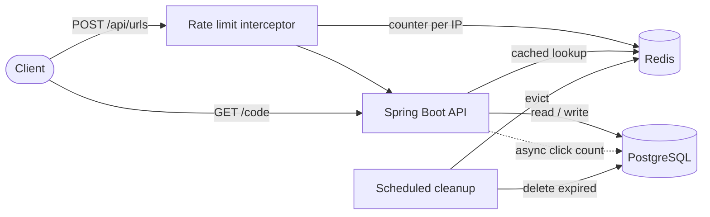
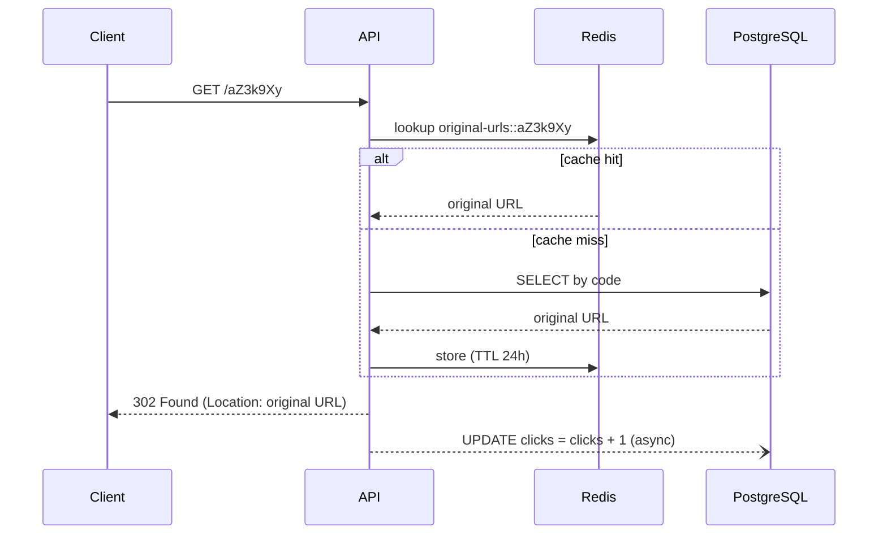

# URL Shortener


A REST API to shorten URLs, redirect to the original URL and track clicks — built to explore
caching, asynchronous processing, rate limiting and database migrations with a modern Java stack.

## Features

- **Shorten URLs** with a random 7-character Base62 code
- **Fast redirects** (`302 Found`) backed by a **Redis cache**
- **Click tracking** processed asynchronously on **virtual threads**, without slowing down redirects
- **Statistics** endpoint per short URL
- **Optional expiration date**: expired URLs return `410 Gone` and are removed by a scheduled job
- **Rate limiting** per IP on URL creation (`429 Too Many Requests` with `Retry-After`)
- **Standard error responses** using RFC 9457 `ProblemDetail`
- **Interactive API documentation** with OpenAPI / Swagger UI

## Tech stack

| Area | Technology |
|---|---|
| Language | Java 25 |
| Framework | Spring Boot 4 (Web MVC, Data JPA, Validation, Cache) |
| Database | PostgreSQL 18 + Flyway migrations |
| Cache & rate limiting | Redis 8 |
| API documentation | springdoc-openapi (Swagger UI) |
| Testing | JUnit 5, Mockito, MockMvc, Testcontainers, Awaitility |
| Infrastructure | Docker Compose, GitHub Actions (CI) |

## Architecture



**Redirect flow**



## API

| Method | Endpoint | Description | Responses |
|---|---|---|---|
| `POST` | `/api/urls` | Create a short URL | `201`, `400`, `429` |
| `GET` | `/api/urls/{code}` | Get statistics of a short URL | `200`, `404` |
| `GET` | `/{code}` | Redirect to the original URL and count the click | `302`, `404`, `410` |

**Create a short URL**

```http
POST /api/urls
Content-Type: application/json

{
  "url": "https://www.github.com",
  "expiresAt": "2026-12-31T23:59:59Z"
}
```

`expiresAt` is optional; without it, the URL never expires.

```json
{
  "code": "aZ3k9Xy",
  "shortUrl": "http://localhost:8080/aZ3k9Xy",
  "originalUrl": "https://www.github.com",
  "clicks": 0,
  "createdAt": "2026-11-02T22:30:00Z",
  "expiresAt": "2026-12-31T23:59:59Z"
}
```

**Error example** (`ProblemDetail`)

```json
{
  "type": "about:blank",
  "title": "Short URL not found",
  "status": 404,
  "detail": "No existe ninguna URL con el código: abcdefg",
  "instance": "/abcdefg"
}
```

Full interactive documentation is available at `/swagger-ui.html` once the application is running.

## Getting started

### Prerequisites

- JDK 25
- Docker (Docker Desktop on Windows/macOS)

### Run the application

```bash
git clone https://github.com/raulced7/url-shortener.git
cd url-shortener
./mvnw spring-boot:run        # Windows: .\mvnw.cmd spring-boot:run
```

Spring Boot's Docker Compose support starts PostgreSQL and Redis automatically from `compose.yaml` —
no manual database setup or connection properties are needed.

- API: `http://localhost:8080`
- Swagger UI: `http://localhost:8080/swagger-ui.html`
- OpenAPI spec: `http://localhost:8080/v3/api-docs`

### Try it with Postman

Import [`postman/url-shortener.postman_collection.json`](postman/url-shortener.postman_collection.json).
Run **Create short URL** first: it stores the generated code in the `{{code}}` collection variable used
by the other requests. Every request includes automated tests.

### Run the tests

```bash
./mvnw verify                 # Windows: .\mvnw.cmd verify
```

Integration tests run against **real PostgreSQL and Redis containers** via Testcontainers (Docker must be running).
The same suite runs on every push with GitHub Actions.

## Configuration

| Property | Default | Description |
|---|---|---|
| `app.rate-limit.requests-per-minute` | `10` | Max short URLs created per IP per minute |
| `app.cleanup.fixed-delay-ms` | `60000` | Interval of the expired-URL cleanup job |
| `spring.threads.virtual.enabled` | `true` | Run async tasks on virtual threads |

## Technical decisions

**Random Base62 codes instead of encoding the database ID.** Encoding the auto-generated ID is
collision-free, but the ID only exists after the insert while the `code` column is mandatory, and
sequential IDs make every short URL guessable. A random 7-character Base62 code gives ~3.5 trillion
combinations; uniqueness is checked before saving and enforced by a `UNIQUE` constraint.

**`302 Found` instead of `301 Moved Permanently`.** Browsers cache 301 redirects and skip the server on
later visits, so clicks would be lost. A 302 makes every visit go through the API.

**Caching only the original URL.** The code → URL mapping is immutable, so it can be cached without
invalidation logic. Statistics are not cached because the click count changes constantly. The cache is
accessed through Spring's cache abstraction (`@Cacheable`), so the business logic does not depend on Redis.

**Atomic, asynchronous click counting.** Clicks are incremented with a single
`UPDATE ... SET clicks = clicks + 1`, avoiding lost updates under concurrency (no read-modify-write).
The update runs in an `@Async` method on virtual threads, so the redirect is returned immediately.
*Trade-off:* if the application crashes right after a redirect, that click may be lost — acceptable for analytics.

**Rate limiting with a Redis counter.** A fixed-window counter per IP (`INCR` + `EXPIRE`) works across
multiple application instances because the state lives in Redis. *Trade-off:* fixed windows allow bursts
at window boundaries; a token bucket (e.g. Bucket4j) would smooth traffic at the cost of extra complexity.

**Expiration with scheduled cleanup.** Expired URLs return `410 Gone` (the resource existed but is no
longer available). A scheduled job deletes them in a single batch statement and evicts them from the cache.
A partial index (`WHERE expires_at IS NOT NULL`) keeps the cleanup query fast without indexing URLs that
never expire. *Trade-off:* a cached URL may keep redirecting for up to one cleanup interval after expiring.

**Schema managed by Flyway.** Hibernate only validates the schema (`ddl-auto: validate`); every change is
a versioned migration, never an edit of an already applied one.

**Code-first OpenAPI.** The specification is generated from the code with springdoc. For APIs shared
between teams, a contract-first approach (writing the OpenAPI YAML first and generating code) would be preferable.

## Possible improvements

- Buffer click counts in Redis (`INCR`) and flush them to PostgreSQL periodically to reduce database writes
- Distributed lock for the cleanup job (e.g. ShedLock) when running multiple instances
- Batch deletion with pagination for very large volumes of expired URLs
- Read the client IP from `X-Forwarded-For` (`server.forward-headers-strategy`) when deployed behind a load balancer
- Authentication so users can manage and delete their own URLs
- Deployment to AWS

## Project structure

```
src/main/java/com/raulcedroj/url_shortener
├── config        # Async, cache, scheduling, OpenAPI, web and rate-limit configuration
├── controller    # REST endpoints and redirect
├── dto           # Request and response records
├── entity        # JPA entities
├── exception     # Custom exceptions and global ProblemDetail handler
├── ratelimit     # Redis-based rate limit interceptor
├── repository    # Spring Data JPA repositories
└── service       # Business logic, cache lookup, click tracking, cleanup job
```

## Author

**Raúl Cedeño Rojo** — Backend Developer (Java · Spring Boot)
[LinkedIn](https://www.linkedin.com/in/raulcedroj/)
